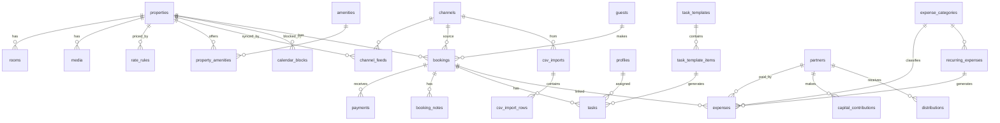

# SAHA Residences: Phase 0 plan (website + operations dashboard)

## Context
SAHA Residences (4 partners) runs one home today, DHA Retreat in DHA Phase 9, Lahore. It has 3 bedrooms, 4 baths, sleeps 6 and costs USD 60 a night. Bookings arrive from Airbnb, Booking.com, WhatsApp and offline. There is no direct-booking site and no single record of bookings, costs or partner profit. We are building two things on one data model:
1. a fast, pre-rendered public site that ranks locally and turns mobile visitors into direct bookings, and
2. a private, mobile-first dashboard covering every booking, task, expense, P&L line and partner balance.

The folder (`C:\Claude projects\saha`) is not a git repo yet. It holds 9 JPEGs, all 1600px or smaller (WhatsApp-compressed), plus `logo.jpeg` (white on grey, no transparency), two flyers and an 82 MB walkthrough video. There is no code yet.

**Answers so far:** brand guide read from the artifact link (tokens in `design/brand-tokens.json`). Business **not registered yet**, so launch with a request flow and no card gateway. Show the **area only** until a booking is confirmed. **Admin login only** for now, with staff and partner roles defined and tested in RLS.

---

## 1. Where the brief is outdated, wrong or risky (read first)
| # | Brief says | What I found | What I'll do |
|---|---|---|---|
| 1 | NAP matching "the Google Business Profile I'll set up" | Google's *Business eligibility guidelines* list **vacation homes and rental properties as ineligible** for a Business Profile. A listing risks suspension. | Keep NAP identical everywhere for citations. Don't create a GBP for the house. The property already shows in Google's lodging results through Airbnb and Booking.com. Revisit if you open a staffed office guests visit. |
| 2 | VacationRental structured data | Google's VacationRental rich result is **limited to Hotel Center partners** working with a Google Technical Account Manager. An interest form doesn't guarantee entry. | Add VacationRental markup only to help understanding, and claim no rich result. |
| 3 | FAQ structured data (implied) | FAQ rich results have been limited to authoritative government and health sites since 2023. Search Engine Journal reports full deprecation in June 2026. I could not confirm that on Google's own docs. | Keep a visible FAQ page with **no FAQPage markup**. |
| 4 | Review markup | Google's review-snippet doc says an entity that controls reviews about itself **can't get star snippets** (LocalBusiness/Organization). | Show reviews visibly with source and date. No Review or AggregateRating markup. |
| 5 | Admin password `SAHA1212` | It's 8 characters, guessable, and now sits in chat history. | Never commit it. Set a 15+ character passphrase at account creation, plus **TOTP MFA** (Supabase Auth, free). |
| 6 | "robots.txt alone is not protection" | Correct. robots.txt is public (it advertises the path), it's advisory, and a disallowed URL can still be indexed if it's linked. Disallowing `/admin` would also **stop Google seeing the noindex header**. | Use auth on every admin route, an `X-Robots-Tag: noindex, nofollow` header, no links from public pages, and no robots.txt entry. |
| 7 | "Automated daily backups" on near-zero cost | Supabase Free has **no automatic backups** and **pauses after 1 week of inactivity** (pricing page). | Run a nightly `pg_dump` and receipts sync to Cloudflare R2 from GitHub Actions, with a monthly scripted restore drill. Move to Pro (USD 25/mo, 7-day daily backups) when revenue justifies it. |
| 8 | Separate Reviews page | It would be thin with a handful of reviews. | Put reviews on Home and The Stay first. Add `/reviews/` once there are 10+ to show. |
| 9 | llms.txt | Google says Search doesn't use it and it "won't harm (nor help)". John Mueller says no AI service has confirmed using it. | Skip it. Write clear, factual on-page statements instead. |
| 10 | Photos | Longest edge is 1600px or less, so they're soft on desktop retina. There are no bathroom, kitchen, games room, workspace or exterior shots. The logo is a JPEG on grey. | **Please send the original camera files, the missing rooms and an SVG or transparent PNG logo.** Phase 2 ships with what we have plus marked placeholders. |
| 11 | Phone | The flyer lists +92 320 5361616 **and** +92 312 3777705. | Use one public number everywhere (default: 320). |
| 12 | Driving guests off Airbnb | Airbnb's off-platform policy restricts steering Airbnb guests to book elsewhere. I haven't re-read the current wording. | Never mention the site in Airbnb messages or the listing. Grow direct bookings through search, WhatsApp and repeat guests. |
| 13 | Vercel (if considered) | The Hobby plan is for non-commercial use. | We host on Cloudflare (see section 3). |

## 2. Clarifying questions (max 10)
**All answered (2026-10-18).** These answers override anything below that conflicts:
1. Brand guide: read from the artifact link.
2. Not registered, so Option A.
3. Area only until a booking is confirmed.
4. Admin only. Staff and partner roles stay in RLS.
5. **DHA Phase 9 Town. +92 320 5361616 is the only public number.**
6. **Pricing:**
   - Base **USD 60/night** for up to **6 guests**.
   - **Maximum 8 guests.** Guests 7–8 each need extra bedding at **PKR 1,000 per bedding per night**.
   - Guests can see and pay in **USD or PKR**.
   - **Payment schedule:**
     - A **20% security deposit** (20% of the stay total) is paid up front to confirm.
     - It is a **separate damage deposit**: held, not counted as revenue, and returned after checkout if nothing is damaged.
     - The **full stay price is paid at check-in**.
   - Cancellation terms are still a placeholder.
7. Partner economics: no answer yet, so the default applies (pro-rata to cumulative capital, computed monthly; partner-paid expenses reimbursable by default).
8. Booking.com iCal: **skipped for now.** The channel stays in the list with no feed.
9. Reminders: **email.**
10. Admin login: **ammadali33@gmail.com**, with a 15+ character passphrase and TOTP MFA (default accepted).
11. Photos: **use the folder photos plus marked placeholders.**

Effects on the build:
- `quote()` mixes currencies: the base rate is USD and extra bedding is PKR. One **manual USD→PKR display rate**, set in the dashboard, converts between them. Each quote stores the currency chosen and the rate used.
- Deposits get their own payment kinds (`deposit_received`, `deposit_refunded`, `deposit_retained`). They're excluded from revenue and shown as **deposits held**. A retained amount only becomes other income when you record a deduction.
- `max_guests` is 8 and `included_guests` is 6. The guest stepper goes up to 8. Copy reads "Sleeps 6, up to 8 with extra bedding". VacationRental occupancy is 8.

Original questions, kept for reference:
5. **Location precision:** is it DHA Phase 9 **Town** (the flyer says "DHA 9 Town Park") or Phase 9 **Prism**? Which single public phone number should we use? [Phase 9 Town; +92 320 5361616]
6. **Pricing rules:** show USD only, or USD plus approximate PKR? Is there a cleaning fee, an extra-guest fee, a minimum stay, weekly or monthly discounts, and what advance % do you take? [USD with approx. PKR; no fees; 1-night minimum; advance % left as a marked placeholder]
7. **Partner economics:** are profit shares pro-rata to cumulative capital (recomputed as contributions change), or fixed % in a written agreement? When a partner pays a business expense personally, is it **reimbursable** or **added to their capital**? [pro-rata cumulative capital, computed monthly; reimbursable by default, switchable per expense]
8. **Booking.com:** is the listing live? Please send its iCal export URL. Are there any other platforms? [Booking.com feed added when you send it]
9. **Reminders:** is email OK? If we add phone push later, is your phone iPhone or Android? [email]
10. **Admin login:** which email should the admin account use? Do you accept a 15+ character passphrase plus TOTP MFA in place of `SAHA1212`? [yes]

## 3. Architecture and stack
**One Astro project, deployed to Cloudflare Workers. Public pages are pre-rendered at build. `/admin/*` and `/api/*` render on demand. Supabase provides Postgres, Auth, Storage and RLS.**

| Decision | Why (evidence) | Cost | Simpler option? |
|---|---|---|---|
| **Astro** (current stable, checked at setup) with `export const prerender = true` on public pages, on-demand rendering for admin and API | Astro ships zero JS by default. Islands only load JS on pages that use them, so no admin code reaches public visitors (Astro docs: islands, on-demand rendering). | One framework to learn | A separate admin SPA means two builds and two deploys, and gives no benefit for one admin. Rejected. |
| `/admin` in the same app, not a subdomain | One deploy, one domain and cert. Middleware enforces auth, noindex and a no-analytics policy on `/admin/*`. | Shared origin (mitigated by HttpOnly SameSite cookies, CSP) | A subdomain adds DNS and CORS work for no real gain. Can move later. |
| **Cloudflare Workers** (static assets + `@astrojs/cloudflare`) | The free plan allows commercial use, with 100k requests a day. Static assets are served free. Cron Triggers are included (5 per account on Free). | 10 ms CPU per invocation on Free. I/O wait doesn't count. | Netlify would also work. Cloudflare wins on including cron, R2 and Web Analytics in one account. If the CPU limit bites, Workers Paid is USD 5/mo. |
| **Supabase** (Postgres, Auth with TOTP MFA, Storage, RLS) | Managed Postgres with built-in auth, and RLS enforced in the database. Free plan: 500 MB DB, 1 GB storage, 2 projects (staging + prod). | Free tier pauses after 7 days idle, and it has no backups (see 1.7) | Neon has no auth or storage, so we'd add more pieces. Rejected. |
| UI: Astro pages with HTML forms and **Astro Actions** (progressive enhancement). **Preact** islands only for the calendar, date picker and quick-add | Forms work without JS and stay accessible. Preact is about 4 KB. | Two rendering styles | Full React would be heavier for no gain here. |
| Plain CSS with **custom properties imported from the brand guide tokens** | The guide is the source of truth, and tokens map 1:1 to CSS variables. | None | Tailwind would add a build layer and a second token system. Rejected. |
| Zod (bundled with Astro), `ical.js` (Mozilla, runs on Workers), Vitest, Playwright + axe-core, Supabase CLI + pgTAP for RLS tests | Standard, maintained, and each has a single purpose | Dev-only, except ical.js which runs server-side | n/a |
| Content changes (price, photos, listings) | The dashboard writes to the DB. A **"Publish site"** button calls GitHub `repository_dispatch`, which rebuilds and redeploys in about 2 minutes. Live availability and quotes always come from the API. | Needs a GitHub token in Worker secrets | Rendering public pages on demand would lose pre-rendered speed. Rejected. |
| Virtual tour | Upload the walkthrough to **YouTube** (free adaptive streaming, discoverable). Embed through a click-to-load facade (poster image, `youtube-nocookie`), so there's no third-party JS until the visitor clicks. | YouTube branding after the click | Self-hosting an 82 MB file would need transcoding and adaptive streaming. Rejected. |
| Map | A styled placeholder with a "Show map" button that loads the Google Maps Embed iframe (free) of the **area** (Phase 9) on click, plus an "Open in Google Maps" link | One iframe, only after the click | n/a |
| Email (booking alerts, reminders, job failures) | **Resend** free tier (the vendor says 3,000/mo and 100/day; I'll check at signup). Until the domain exists, it can only send to your own address, which is enough for one admin. | One vendor | WhatsApp API rejected for now (section 10). |
| Analytics | **Cloudflare Web Analytics** (cookieless, free, includes Core Web Vitals RUM). Plus **first-party conversion events** (`booking_started`, `booking_request_submitted`, `whatsapp_click`, `phone_click`) sent with `sendBeacon` to `/api/e` and stored without IP. They show on the dashboard. **No cookie banner needed.** | A tiny endpoint to build | GA4 is heavier, sets cookies and needs a consent banner for EU/UK visitors. Rejected. Google Search Console covers search data. |
| Spam on the request form | Honeypot field plus per-IP rate limit in the Worker | None | Add Cloudflare Turnstile only if spam shows up. |
| Staging protection | Staging and preview URLs sit behind **Cloudflare Access** (free up to 50 users) and send `noindex` | Login prompt on staging | n/a |

Environments: Supabase `saha-staging` + `saha-prod`. Worker `saha-staging` + `saha` (prod). Each PR gets a preview URL (`wrangler versions upload`). Secrets live in Worker secrets and GitHub Actions secrets only. `.env.example` is committed and `.env` is gitignored.

Scheduled jobs: **one Cron Trigger per environment, every 15 min**, running a dispatcher:
- iCal pull on every tick
- reminders on every tick
- recurring-expense drafts daily at 06:00 PKT
- daily digest at 08:00 PKT

Every run writes `job_runs`. A failure emails you. Each successful run pings **Healthchecks.io** (free), which alerts you if runs *stop*. The dashboard shows a red banner if any feed is more than 2 hours stale. The 15-minute pings also count as activity, which should prevent free-tier pausing. I couldn't verify which activity Supabase counts, so we watch for it.

## 4. Data model (ERD)
All money is stored as `bigint` minor units plus `currency char(3)`. Every FX-bearing row stores `fx_rate_to_pkr numeric(18,8)` and a generated `amount_pkr_minor`. Originals are never overwritten. Stay dates are `date`, timestamps are `timestamptz`, and the business timezone is `Asia/Karachi`. Financial tables use soft delete (`deleted_at`). Triggers on bookings, payments and expenses (and the partner capital tables) write to `audit_log`.



Key tables and columns:
- **properties**: slug, name, status (draft/published), bedrooms, bathrooms, max_guests, area_label, approx_lat/lng (area centroid), check_in_time, check_out_time, base_rate_minor, base_currency, min_nights, extra fees (nullable), public_description. Support for more listings is built in from day one.
- **rooms** (name, beds, description, sort) · **amenities** / **property_amenities** · **media** (storage_path, slug_filename, alt, caption, room_id, sort, is_hero, width, height, published)
- **rate_rules**: date range, nightly_rate_minor, currency, min_nights, label. Seasonal overrides sit on top of the base rate. One shared `quote()` function runs on both server and client.
- **channels**: editable list (Airbnb, Booking.com, Direct website, WhatsApp, Walk-in, Other), kind (platform/direct/offline), default_commission_pct, active
- **channel_feeds**: property, channel, import_url (secret), last_success_at, last_error, consecutive_failures
- **calendar_blocks**: property, start, end, reason, source (manual / ical), external_uid. Airbnb's "Not available" events land here, not in bookings.
- **guests** (minimal): full_name, phone_e164, email, country, created_at. No ID documents.
- **bookings**:
  - who and where: property, channel, guest_id (nullable until details are filled)
  - stay: status enum (inquiry, confirmed, checked_in, checked_out, cancelled, no_show), check_in, check_out, `nights` (generated), adults, children, guest_count
  - money: gross_minor, currency, commission_minor, other_fees_minor, taxes_minor, `net_payout_minor` (generated), fx_rate_to_pkr, payout_date, cancellation_retained_minor
  - references: external_ref (e.g. Airbnb `HMXR3FZQM5`, parsed from the feed), ical_uid
  - sync and audit: source (manual/ical/website/csv), needs_details, sync_state (active / missing_from_feed), last_seen_in_feed_at, overlap_flag, created_by, deleted_at
  - payment_status (unpaid, advance received, paid in full, refunded) is **derived** in a view from payments vs gross. Refunded is set by refund rows.
- **payments**: booking, kind (advance/balance/payout/refund), amount_minor, currency, fx_rate_to_pkr, received_on, method, reference, deleted_at
- **booking_notes**: booking, author_id, body, created_at (append-only)
- **tasks**: booking_id?, property_id?, title, details, due_at, assignee_id, status (open/done/skipped), remind_at, reminded_at, template_item_id?, completed_at
- **task_templates** / **task_template_items**: trigger = booking confirmed. Each item has an anchor (check_in/check_out), offset_minutes and remind_offset. Seed items: send check-in details, clean and prepare, welcome guest, mid-stay check, checkout inspection, collect balance, request review.
- **expense_categories**: name, kind (opex/capex). Seeded opex: rent, utilities, internet, cleaner, caretaker, consumables, others. Seeded capex: furniture, fit-out, appliances.
- **expenses**: date, amount_minor, currency, fx_rate_to_pkr, category, vendor (text), payment_method, paid_by_partner_id (null = business account), reimbursable bool, booking_id?, property_id, receipt_path, notes, recurring_expense_id?, status (draft/confirmed), deleted_at
- **recurring_expenses**: category, amount, currency, vendor, frequency, day_of_period, start/end, active
- **partners**: name, email, user_id? · **capital_contributions** / **distributions**: partner, date, amount, currency, fx, notes, deleted_at
- **fx_rates**: date, currency, rate_to_pkr, source = manual. It provides the default rate for new rows, which always keep their own copy.
- **csv_imports** / **csv_import_rows**: raw jsonb, dedupe_hash, matched_booking_id, proposed_action, status (pending/accepted/skipped). Saved column mappings per channel.
- **profiles**: user_id, display_name, role (admin/staff/partner) · **audit_log**: table, row_id, action, old, new, actor, at · **job_runs** · **site_events** (event, path, ts) · **site_settings** (key/value: public phone, WhatsApp number, advance %, policies)

Overlap handling is **warn, not block**, because platform feeds can legitimately create conflicts we must surface. A Postgres function finds overlapping confirmed bookings and blocks across channels. It sets `overlap_flag` and alerts. Website requests are re-checked against availability inside the insert RPC.

## 5. Roles and permissions (enforced by RLS. Only Admin gets accounts now)
| Resource | Admin | Staff (future) | Partner (future) | Anonymous (public site) |
|---|---|---|---|---|
| Bookings: dates, status, guest name, phone | CRUD | Read/update status via `bookings_ops` view (no money columns) | No | No (availability RPC returns date ranges only) |
| Booking money, payments | CRUD (soft delete) | **No** | Aggregates only via report views | No |
| Notes | CRUD | Read, create | No | No |
| Tasks | CRUD all | **Only tasks assigned to them** | No | No |
| Expenses, recurring, receipts | CRUD | No | Read aggregates | No |
| Capital, distributions, partner balances | CRUD | No | Read own rows plus totals | No |
| Reports, P&L | Yes | No | Read | No |
| Site content, pricing, media, blocks | CRUD | No | No | Read published only (at build) |
| Audit log | Read | No | No | No |
| Booking request | n/a | n/a | n/a | Insert via `submit_booking_request` RPC only |

Column-level hiding for staff uses a `security_invoker` view plus revoked table SELECT. pgTAP tests check every cell of this matrix.

## 6. Public sitemap and URLs
```
/                              Home
/stays/                        Listing cards (brand guide pattern; one card now)
/stays/dha-retreat/            The Stay: rooms, layout, full amenities, video tour
/stays/dha-retreat/gallery/    Gallery with keyboard-navigable lightbox
/location/                     DHA Phase 9 neighbourhood, distances, map on click
/book/                         Availability, price breakdown, request form, WhatsApp
/book/thanks/                  noindex, not in sitemap
/faq/   /house-rules/ (rules + cancellation policy)   /contact/
/privacy/   /terms/   404
/reviews/                      only once 10+ reviews exist
/guides/ + /guides/<slug>/     Phase 6, only if you'll write 3+ genuinely useful guides
/corporate-stays/              optional, see keyword map
```
URLs use a trailing slash, lowercase and hyphens. `/stays/<slug>/` scales to more listings. Cloudflare redirect rules handle www to apex, http to https, and slash normalization. The XML sitemap covers public pages only. robots.txt allows all and points to the sitemap. Staging sends noindex.

## 7. Keyword map: hypotheses only, no volumes (validate in Search Console and Keyword Planner)
| Page | Primary | Secondary | Intent |
|---|---|---|---|
| Home | vacation rental DHA Lahore | furnished house per night Lahore; short stay DHA Phase 9; family stay Lahore | Commercial/transactional |
| The Stay | 3 bedroom house for rent per day DHA Lahore | house with games room Lahore; furnished house with workspace Lahore; solar backup rental Lahore | Transactional |
| Gallery | DHA Retreat photos | SAHA Residences Lahore | Navigational (brand) |
| Location | stay near Lahore airport DHA | accommodation near Allama Iqbal International Airport; stay near DHA Raya / Dolmen Mall DHA | Commercial/local |
| Book | book DHA Retreat Lahore | DHA Retreat availability | Transactional (brand) |
| FAQ | (questions as H2s, e.g. "is there power backup") | — | Informational |
| House rules | DHA Retreat house rules | cancellation policy | Navigational |
| Corporate stays (opt.) | corporate guest house Lahore | monthly furnished house DHA Lahore; company accommodation Lahore | Commercial |
| Guides (opt.) | family friendly places near DHA Lahore | things to do in Lahore with kids; Lahore itinerary 3 days | Informational |

## 8. Booking and payments
**Gateways I checked:**
- **Stripe:** Pakistan is **not** on stripe.com/global (checked today).
- **PayPal:** no merchant accounts in Pakistan (third-party sources only; I couldn't confirm on PayPal's site).
- **Safepay:** full SBP commercial PSP licence in April 2025 (news reports). Accepts **international Visa/Mastercard** via Cybersource. Offers hosted checkout and **payment links**. A third party reports about 3.2% + Rs 30 per international card payment; Safepay's own pricing is unverified. Onboarding needs a registered business.
- **PayFast (Pakistan, APPS):** SBP-licensed. International cards unverified.
- **Bank gateways (HBL/UBL):** possible, but onboarding is heavy.

| Option | Pros | Cons |
|---|---|---|
| **A. Calendar + request + WhatsApp + manual advance** | Zero fees, works without registration, and fits how Pakistani guests already book | Manual confirmation. Foreign guests have to pay by bank transfer, Wise or remittance, or pay on arrival. |
| B. PMS widget (Lodgify, Hostaway, Smoobu…) | Real API channel sync. The only realistic route to API-level payout data. | USD 30–100+/mo. Their payment processing mostly runs on Stripe or PayPal, which aren't available to Pakistani merchants (check per vendor). Duplicates the dashboard you asked for. |
| C. Custom engine + Safepay | Instant booking, card advance | Needs registration and onboarding, plus refund, chargeback and webhook work. Not worth it at current volume. |

**Recommendation: A now.** Once you register, add a **Safepay payment link** to the confirmation message, which needs no code. Move to **C** only if direct volume makes manual confirmation a bottleneck.

Flow:
1. `/book` loads one island that fetches `/api/availability` (blocked date ranges only, with no guest data).
2. The guest picks dates and a guest count and sees a live price breakdown from `quote()`.
3. The request form asks for name, WhatsApp number, optional email, guests, trip type (family/corporate/other) and a message.
4. The RPC re-checks dates and price and creates an `inquiry` booking (channel Direct website). You get an email.
5. The thank-you page shows **"Continue on WhatsApp"**: `https://wa.me/923205361616?text=` plus an encoded message with booking ref, dates, nights, guest count and quoted total. A generic WhatsApp CTA (no dates) appears site-wide.
6. Inquiries don't block dates. Confirming one blocks them and generates tasks.

**iCal export:** there's one feed per consumer, so a platform never re-imports its own bookings:
- `/ical/<slug>-airbnb-<token>.ics` carries everything except Airbnb-sourced events.
- the Booking.com feed works the same way.

Events say "Blocked" and carry no guest data. Each token can be rotated.

**Sync limits and the remaining double-booking window:**
- Airbnb's Help Center says imported calendars refresh **about every 3 hours** (hosts can press Refresh, and requests are rate-limited).
- Booking.com's import interval: I **couldn't verify** it on official docs.
- We pull platform feeds every 15 min.

So a WhatsApp booking can stay invisible to Airbnb for up to ~3 h, and possibly longer on Booking.com. Mitigation: when you confirm a booking that starts within 7 days, the dashboard prompts you to block the dates manually in the platform apps.

## 9. Channel data: what's actually available
- **Airbnb iCal** (checked against your feed). It contains `Reserved` events with the **reservation code** and last 4 phone digits (which we don't store), plus `Airbnb (Not available)` blocks. There are no names or amounts. We match on reservation code first, then UID.
- **Booking.com iCal:** dates only. Every event arrives as "needs details".
- **Airbnb API:** closed to new partners (vendor sources say it's invitation-only).
- **Booking.com Connectivity API:** for connectivity providers, not single hosts.
- **Realistic payout route: CSV import.** Airbnb's Transaction History export (Help article 418: gross earnings, host fee, payouts, confirmation codes) matches bookings by code. Booking.com's extranet export format is unverified, so the importer has a **column-mapping step** saved per channel. Import flow: parse, dedupe by hash, show a diff (create / update / skip), then you confirm. Nothing saves before you review it.
- **Sync rules:**
  - A new UID creates a booking (`needs_details`) or a block.
  - Changed dates update the booking, write an audit row and re-check overlaps.
  - An event that's missing from the feed with check-out ≥ today gets flagged **"possibly cancelled"**. Past events drop out of feeds normally and aren't flagged.
  - Nothing is ever auto-deleted.

## 10. Reminders
**Email** (Resend), with a daily 08:00 digest of your tasks plus a per-task reminder at `remind_at`. It's free and reliable for one admin.

WhatsApp Business Platform: Meta's docs say it now charges per delivered template message by recipient country. Utility templates are free only inside the 24-hour customer-service window. You'd also need a Meta business setup and template approval. That's not justified for reminding one admin. Phone push (web push from an installed dashboard PWA) is an optional Phase 6 item. On iPhone it requires adding the dashboard to the Home Screen.

## 11. Finance rules (unit-tested with worked examples)
- **Reporting currency: PKR** (confirmed by your brief, and most costs are PKR).
  - Each row converts at its own stored rate. Booking revenue uses the booking's rate. Payments use the rate on the date received.
  - No realized FX gain or loss tracking (limitation noted).
- **Revenue recognition: accrual per night.** A stay that crosses a month end splits across both months. A separate **cash report** shows payments received vs outstanding.
- **P&L layout:**
  - Gross booking revenue
  - − channel commissions, − taxes withheld = **net revenue**
  - − opex by category = **operating profit**
  - Capex is excluded from the P&L and shown under **payback**: cumulative operating profit ÷ total capital invested.
- **Cancellations:** only retained amounts count as revenue, recognized on the cancellation date. Refund rows reduce cash.
- **Metrics:**
  - occupancy = booked nights ÷ available nights (owner and maintenance blocks excluded)
  - ADR = room revenue ÷ booked nights
  - RevPAN = room revenue ÷ available nights
  - ALOS = nights ÷ stays
  - commission by channel
- **Partners:** ownership % for each month = cumulative contributions in PKR ÷ total, as of that month's end. Each month's profit or loss is allocated at that month's %, and a period is the sum of its months. Running balance = allocations − distributions + unpaid reimbursements.
- Recurring expenses generate **drafts**. They don't count until you confirm them.
- Exports: CSV, plus a **print-optimized report page** you save as PDF. Server-side PDF on Workers would need headless Chrome, which isn't available on Free, and the print page covers 90% of the need.

## 12. Structured data (JSON-LD, only content visible on the page)
| Type | Page | Rich result for us today? |
|---|---|---|
| WebSite (name, url) | Home | **Yes**: feeds Google's *site name* feature |
| Organization (name, logo, sameAs, telephone) | Home | Logo and knowledge signals only. No rich result. |
| VacationRental → containsPlace Accommodation (bedrooms, bathrooms, occupancy 6, beds, amenityFeature, images, address at locality level) | The Stay | **No** (Hotel Center partners only). Helps understanding. No geo, because we only publish the area. |
| BreadcrumbList | Stay, Gallery, Guides | Breadcrumb display, desktop at least. I couldn't confirm current mobile behaviour. Cheap to add. |
| FAQPage, Review, AggregateRating | — | **Not used** (see 1.3, 1.4) |

Validated with the Rich Results Test and validator.schema.org at the end of Phase 2.

## 13. Phased build plan and acceptance criteria
Every phase ends with the **quality gates** from your brief:
- zero build errors and warnings
- mobile Lighthouse scores reported (95+ on all four for public pages)
- HTML, JSON-LD, sitemap and robots validated
- pgTAP permission tests
- Playwright at 360/768/1440 with axe (WCAG 2.2 AA)
- brand-guide check
- clear commits
- a short report: built, left out, risks

**Phase 1: Foundation, data model and auth**
- Work: git init, Astro + Cloudflare adapter, Supabase staging/prod, all migrations, RLS, audit triggers, admin login with MFA, `/admin` middleware (auth + noindex + no analytics), CI, nightly backup to R2, restore drill, realistic staging seed, CLAUDE.md and DECISIONS.md.
- Acceptance:
  - Migrations apply from empty.
  - pgTAP covers the full section 5 matrix: anon sees nothing, staff can't read money or others' tasks.
  - Every `/admin/*` route redirects when logged out, and responses carry `X-Robots-Tag: noindex`.
  - A backup restores into a scratch DB with matching row counts.

**Phase 2: Public site**
- Work: all pages, brand tokens and self-hosted subset fonts, image pipeline (AVIF/WebP, srcset, width/height, preloaded hero with `fetchpriority=high`), SEO meta, OG/Twitter cards plus designed share images (1200×630, checked in a WhatsApp preview), JSON-LD, sitemap, robots, the Book flow with availability, quote, request and WhatsApp, conversion events, original copy with marked placeholders.
- Acceptance:
  - Mobile Lighthouse ≥95 ×4 on every template, with LCP < 2.5 s, CLS < 0.1, and INP measured on the Book page.
  - No JS on public pages except the Book island, gallery lightbox, facades and beacon.
  - Rich Results Test shows no errors.
  - Keyboard-only booking request works.

**Phase 3: Channel sync**
- Work: iCal import/export, dispatcher cron, job_runs, failure email, Healthchecks ping, stale-feed banner, overlap detection, CSV import with review step.
- Acceptance: tests pass against fixture feeds for:
  - new, changed and removed future events, and removed past events (not flagged)
  - Airbnb blocks vs reservations
  - cross-channel overlap
  - malformed feed (alert fires)
  - duplicate CSV re-import (zero new rows)

**Phase 4: Dashboard operations and site control**
- Work: unified list with filters, month calendar, today's arrivals and departures, **quick add under 30 s** (channel, dates, name, phone, amount, with sensible defaults), booking detail with payments, notes and tasks, task templates generating checklists, standalone tasks, My tasks today, email reminders and digest. Plus **pricing and rate rules, calendar blocks, media upload, replace and reorder with alt text, add or edit listings, and a Publish button**.
- Acceptance:
  - Timed quick add on a 360 px phone takes under 30 s.
  - Confirming a booking generates correctly timed tasks.
  - A price change published from the dashboard is live in about 2 min.

**Phase 5: Finance and reports**
- Work: expenses with receipts, recurring drafts, opex/capex split, FX, partners (capital, ownership, shares, distributions, balances), all reports for any period, home overview, CSV and print-to-PDF.
- Acceptance: Vitest worked examples covering:
  - P&L with a month-straddling stay
  - USD booking and PKR expenses
  - partial payments
  - cancellation with retention
  - refund
  - ownership change mid-year
  - partner-paid reimbursable expense

  All figures must match a hand-calculated spreadsheet included in the repo.

**Phase 6 (optional):** guides section, Safepay payment link or checkout after registration, web push.

## 14. Estimated monthly running cost
| Item | Cost |
|---|---|
| Cloudflare Workers, static hosting, cron, Web Analytics, Access, R2 (<10 GB) | USD 0 |
| Supabase ×2 (Free) | USD 0, or **USD 25 for prod on Pro** (recommended once revenue is steady) |
| Resend, Healthchecks.io, GitHub (private repo, Actions) | USD 0 within free tiers |
| Domain (.com at Cloudflare Registrar, at cost) | ~USD 10–12/yr ≈ USD 1/mo (check the price at purchase) |
| Safepay (later) | per transaction only (~3.2% + Rs 30 international, unverified) |
| **Total** | **~USD 1/mo** (USD 26 with Supabase Pro) |

## 15. After approval: files I create first (still Phase 0)
**Brand tokens (read from the guide artifact `claude.ai/artifact/Gsy32cPwyDA38hCybEFtFG`, v1.0, Oct 2026).** `src/styles/tokens.css` is generated from the guide's own `T` token object, and its values are copied verbatim:
- **Color.** Core: stone `#EDE8E0` (page), charcoal `#262523` (text), walnut `#6B4430` (primary/links/selected), olive `#5C6235` (positive accents, ~3% of a page). Tints: stone-50 `#F6F3EE`, stone-200 `#E2DCD2`, line `#D8D1C6`, line-strong `#8A8279` (form borders, 3:1), muted `#5E5850`, line-dark `#4A4743`, muted-dark `#B5ACA0`, walnut-700 `#553524` (hover), walnut-800 `#432A1C`, error `#9B2C2C`, white. Only the guide's 12 approved text pairings are allowed. Walnut and olive are never used as text on charcoal.
- **Type.**
  - Bodoni Moda for headings (22px and up only). Jost for everything else.
  - H1 40/46 → 64/72 (mobile → desktop), H2 32/38 → 48/56, H3 26/32 → 36/44, H4 22/28 → 28/36, H5 18–20, H6 and label 12–13 with tracking .14–.16em. Body 16/26, body-lg 17–18, caption 13/20, button 16→15 weight 500.
  - Desktop sizes apply from 768px. Sentence case. Inputs are 16px on mobile.
  - IBM Plex Mono only appears in the guide's own documentation, so we don't ship it.
- **Space** 4, 8, 12, 16, 24, 32, 48, 64, 96, 128 (8-pt grid). Sections are 96px apart on desktop, 64px on mobile. **Radius** 0 / 2 (buttons, inputs, date cells) / 4 (cards, images, widget) / pill. **Elevation:** 1 = 1px line, no shadow. 2 = `0 8px 24px rgba(38,37,35,.08)`, for popovers, the date picker and the sticky mobile bar only.
- **Containers** text 720, default 1200, wide 1440. **Breakpoints** 480 / 768 / 1024 / 1280. Grid: 4 columns with 20px margins, 8 columns from 768, 12 columns from 1024.
- **Controls** are 48px high (44px minimum touch target). Focus ring is `2px solid #262523` with a 2px offset. One primary button per view. Labels always sit above fields.
- **Icons:** Lucide, 2px stroke, round caps, no fills. Charcoal or stone, walnut only when active. The guide loads them from unpkg. We **inline the SVGs** instead (no CDN request, works offline).
- **Components defined by the guide** (built as Astro components): nav with a Stays dropdown, buttons, inputs, date picker, booking widget, amenity grid, review card, house rules, FAQ accordion, floating WhatsApp CTA (bottom right, above the sticky bar on mobile), listing card, footer, trust blocks ("Book direct and pay less"), and cancellation timeline.
- **Photo rules:**
  - Real rooms only. TVs off, no branded packaging.
  - Text never sits on a photo except on a flat charcoal panel or an even 45% overlay.
  - Under these rules, `WhatsApp Image…jpeg` (snack brands, Netflix on screen) is **excluded** from the site. `lounge.jpeg` (TV on with streaming logos) should be **reshot**, and stays in use only as a placeholder.

**Where the guide and the brief differ (you decide; defaults in brackets):**
1. The guide's pricing demo uses **USD 70 weeknight, USD 90 Fri/Sat, plus a USD 15 cleaning fee**. The brief says **USD 60/night**. [I treat the guide's numbers as demo values and use USD 60 flat. The rate model supports weekday/weekend rates and a cleaning fee if you want them.]
2. The guide's widget says "Secure card payment". Under option A there's no card gateway yet. [Use the guide's bank-transfer wording. Card wording appears only once Safepay is live.]
3. The guide's samples (the review from "Toronto", "Ali" in the WhatsApp greeting, 4.9 rating, check-in 3 pm / check-out 12 pm, free cancellation until 7 days before) are **placeholders**. They ship as marked placeholders until you confirm them.
4. The guide uses a `/stays` index page, so the sitemap gains **`/stays/`** (listing cards; one card for now).

**Design inspiration (Behance "Kings Hideaway"):** I couldn't open it. Behance blocks automated fetches, and the browser pane is paused while a sign-in popup is open. I'll review it in Phase 2 once that popup is closed. It's a layout reference only: hero composition, whitespace, the booking bar in the hero. Where it conflicts with the guide (gold, "luxury" styling, text over gradients), **the brand guide wins**, as the guide itself says.

- **`CLAUDE.md`**:
  - project context (brand, property facts, NAP, channels, roles, PKR reporting, timezone)
  - where tokens live: `src/styles/tokens.css`, generated from the brand guide and never edited by hand
  - stack and folder conventions: `src/pages` (public, prerendered), `src/pages/admin`, `src/pages/api`, `src/lib/finance`, `supabase/migrations`, `supabase/tests`
  - money rules (integer minor units, never float, originals immutable)
  - SEO, performance and accessibility budgets
  - copy rules (brand voice, no em dashes, no hype or filler, marked placeholders for unknown facts)
  - security rules (no secrets in the repo, RLS first, noindex admin, no analytics on admin)
  - the five-step **"question your reasoning"** rule with the DECISIONS.md format
- **`DECISIONS.md`**: every decision in sections 1, 3, 4 and 8–12, in the format *What and why · Evidence · Cost · Simpler option? · Verdict*. Each entry links its source and flags anything I couldn't verify.
- `docs/phase-0-plan.md`: a copy of this plan.

Then I stop and wait for your go-ahead on Phase 1.

## Sources checked (Oct 2026)
- Stripe global availability: https://stripe.com/global
- Google VacationRental structured data: https://developers.google.com/search/docs/appearance/structured-data/vacation-rental
- Google review snippet, self-serving rule: https://developers.google.com/search/docs/appearance/structured-data/review-snippet
- Google Business Profile eligibility: https://support.google.com/business/answer/13763036
- Supabase pricing: https://supabase.com/pricing
- Meta WhatsApp pricing: https://developers.facebook.com/docs/whatsapp/pricing
- Cloudflare Workers limits: https://developers.cloudflare.com/workers/platform/limits
- Airbnb calendar sync: https://www.airbnb.com/help/article/99
- Airbnb transaction history: https://www.airbnb.com/help/article/418
- Safepay licence (Profit, Apr 2025): https://profit.pakistantoday.com.pk/?p=193897
- FAQ deprecation (SEJ, not confirmed on Google docs): https://www.searchenginejournal.com/google-drops-faq-rich-results-from-search/574429/
- Google on llms.txt (Search Engine Land): https://searchengineland.com/google-says-llms-txt-files-wont-harm-or-help-your-search-rankings-480264
- Not verified: Booking.com iCal interval, Booking.com export format, Safepay fees and settlement, PayPal's official Pakistan status, Resend limits, current breadcrumb mobile display.

## Verification (how Phase 1+ gets proven)
- `npm run build`: zero warnings. `npm test`: Vitest finance and sync fixtures. `supabase test db`: pgTAP RLS.
- `npx playwright test`: 360/768/1440 screenshots plus axe.
- Lighthouse CI (mobile) on staging with scores reported.
- Manual checks: Rich Results Test, validator.schema.org, W3C HTML validator, WhatsApp link preview, and a timed quick add on a real phone.
